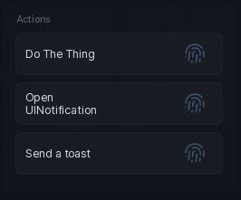

# Button

A row you click. Nothing else to it.

```lua
section:Button({
	Name = "Reset",
	Callback = function()
		print("clicked")
	end,
})
```

## Options

| Key | Type | Description |
| --- | --- | --- |
| `Name` | string | Label on the button. |
| `Callback` | function | Runs on click. |

## Methods

| Method | Description |
| --- | --- |
| `:Click()` | Fire the callback as if the player clicked. |
| `:UpdateName(string)` | Change the label. |
| `:SetName(string)` | Same as `UpdateName`. |
| `:SetVisibility(bool)` | Show or hide. |
| `:GetVisible()` | Returns whether it is showing. |
| `:Destroy()` | Remove the button. |

## Screenshot


