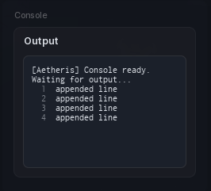

# Console

A scrollback log inside a section. Append lines as they happen, keep the last few hundred, and let it follow the bottom.

```lua
local console = section:Console({
	Name = "Log",
	Height = 160,
	Follow = true,
})

console:Append("[Info] script started")
```

## Options

| Key | Type | Description |
| --- | --- | --- |
| `Name` | string | Title on the panel. |
| `Text` | string | Starting content. |
| `Height` | number | Panel height in pixels. |
| `MaxLines` | number | Lines kept before the oldest rolls off. |
| `RichText` | boolean | Parse `<font>` and `<b>` tags. Off by default. |
| `Follow` | boolean | Stick to the bottom as lines arrive. Off by default. |

With `Follow` on, the panel stays pinned to the newest line and lets go the moment the player scrolls up.

## Methods

| Method | Description |
| --- | --- |
| `:Append(string)` | Add a line to the end. |
| `:Set(string)` | Replace the whole buffer. |
| `:Get()` | Returns the current text. |
| `:Clear()` | Empty the buffer. |
| `:SetHeight(number)` | Resize the panel. |
| `:SetName(string)` | Change the title. |
| `:UpdateName(string)` | Same as `SetName`. |
| `:SetVisible(bool)` | Show or hide. |
| `:GetVisible()` | Returns whether it is showing. |
| `:Destroy()` | Remove the console. |

## Screenshot


