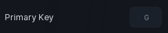

# Keybind

A row that captures a keyboard key. Click the box, press a key, done.

```lua
section:Keybind({
	Name = "Menu key",
	Default = "G",
	Callback = function(key)
		print("pressed", key)
	end,
})
```

## Options

| Key | Type | Description |
| --- | --- | --- |
| `Name` | string | Label for the row. |
| `Default` | string | Starting key, as an `Enum.KeyCode` name. Empty by default. |
| `Callback` | function | Fires when the key is pressed during play. |
| `OnRebind` | function | Fires with the new key whenever the bind changes. |

`Callback` and `OnRebind` do different jobs: the first is "the player pressed the key", the second is "the player chose a different key". All rows share one input listener, so ten keybinds still cost a single `InputBegan`.

Long names are shortened for display (`LeftControl` shows as `LtCtrl`); the value passed to your callbacks stays the full name.

## Methods

| Method | Description |
| --- | --- |
| `:GetBind()` | Returns the current key name. |
| `:SetBind(string)` | Set the key without recording a press. |
| `:SetName(string)` | Change the label. |
| `:SetVisible(bool)` | Show or hide. |
| `:GetVisible()` | Returns whether it is showing. |
| `:Destroy()` | Remove the row and its bindings. |

## Screenshot


