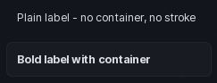

# Label

One line of text in a container. Use it for short readouts you want visually separated.

```lua
section:Label({
	Text = "Status: ready",
	TextSize = 14,
})
```

## Options

| Key | Type | Description |
| --- | --- | --- |
| `Text` | string | The text shown. |
| `TextSize` | number | Font size. Defaults to `14`. |
| `FontWeight` | Enum.FontWeight | Font weight of the text. |
| `Padding` | number | Inner padding of the container. |
| `ShowContainer` | boolean | Draw the background box. On by default. |
| `ShowStroke` | boolean | Draw the border. On by default, needs the container. |
| `TextTransparency` | number | Fade the text, `0` to `1`. |

Setting `ShowContainer = false` leaves just the bare text, which reads better over a busy background.

## Methods

| Method | Description |
| --- | --- |
| `:SetName(string)` | Change the text. |
| `:SetTextTransparency(number)` | Fade the text in or out. |
| `:SetFontWeight(Enum.FontWeight)` | Change the weight. |
| `:SetShowContainer(bool)` | Show or hide the box. |
| `:SetShowStroke(bool)` | Show or hide the border. |
| `:SetVisible(bool)` | Show or hide the whole row. |
| `:GetVisible()` | Returns whether it is showing. |
| `:Destroy()` | Remove the label. |

## Screenshot


