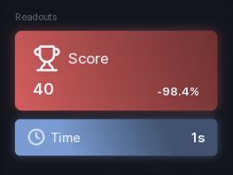

# Live Stat

A big number with a label, a change indicator and an optional icon. The digits roll like an odometer when the value changes.

```lua
local stat = section:LiveStat({
	Name = "Coins",
	Value = 1240,
	Prefix = "",
	Suffix = "",
})

task.spawn(function()
	while task.wait(2) do
		stat:Set(math.random(1000, 9999))
	end
end)
```

## Options

| Key | Type | Description |
| --- | --- | --- |
| `Name` | string | Label under the number. |
| `Value` | number | Starting value. |
| `Prefix` | string | Text before the number, e.g. `$`. |
| `Suffix` | string | Text after the number, e.g. ` pts`. |
| `Icon` | string | Asset id shown beside the value. |
| `ShowChange` | boolean | Show the change line. On by default. |
| `ChangeMode` | string | `"percentage"` (default) or `"absolute"`. |
| `ChangeBaseline` | string | Compare against `"previous"` (default) or `"initial"`. |
| `Size` | string | `"Full"` (default) or `"Compact"` layout. |
| `SpinningEnabled` | boolean | Animated accent. On by default. |

The change line reads the difference since the last value (`previous`) or since the first one (`initial`), as a percentage or a raw amount.

## Methods

| Method | Description |
| --- | --- |
| `:Set(value)` | Set the value. Rolls the digits and updates the change line. |
| `:Get()` | Returns the current value. |
| `:SetName(string)` | Change the label. |
| `:UpdateName(string)` | Same as `SetName`. |
| `:SetVisible(bool)` | Show or hide. |
| `:GetVisible()` | Returns whether it is showing. |
| `:Destroy()` | Remove the stat. |

## Screenshot


