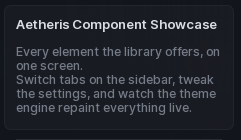

# Paragraph

A title with a block of description text under it. Good for notes and explanations that do not fit in a label.

```lua
section:Paragraph({
	Title = "About this feature",
	Description = "Runs on every frame. Turn it off if you need the performance.",
})
```

## Options

| Key | Type | Description |
| --- | --- | --- |
| `Title` | string | Heading line. |
| `Name` | string | Alias for `Title`. |
| `Description` | string | Body text. |
| `Text` | string | Alias for `Description`. |

`Description` accepts rich text, so you can bold or colour parts of it with `<font>` and `<b>` tags.

## Methods

| Method | Description |
| --- | --- |
| `:SetTitle(string)` | Change the heading. |
| `:SetDescription(string)` | Change the body text. |
| `:SetVisibility(bool)` | Show or hide. |
| `:GetVisible()` | Returns whether it is showing. |
| `:Destroy()` | Remove the paragraph. |

## Screenshot


