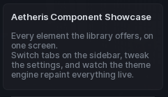

# Paragraph

A title with a block of description text under it. Good for notes and explanations that do not fit in a label.

```lua
section:Paragraph({
	Title = "About this feature",
	Description = "Runs on every frame. Turn it off if you need the performance.",
})
```

## Options

| Key | Type | Description |
| --- | --- | --- |
| `Title` | string | Heading line. |
| `Description` | string | Body text. |

`Description` accepts rich text, so you can bold or colour parts of it with `<font>` and `<b>` tags.

## Links

Inline links work in the body with `{label:destination}`:

```lua
section:Paragraph({
	Title = "Aetheris",
	Description = "Visit {the GitHub repository:copy:https://github.com/Saint0-0/Aetheris} or open {UI Settings:UI Settings}.",
})
```

- `{label:page}` opens a settings page first, then a sidebar tab with that name.
- `{label:copy}` copies the label text.
- `{label:copy:value}` copies `value` instead.

Links are clickable inside wrapped text, styled with the theme accent, and copying shows a toast.

## Methods

| Method | Description |
| --- | --- |
| `:SetTitle(string)` | Change the heading. |
| `:SetDescription(string)` | Change the body text. |
| `:SetVisible(bool)` | Show or hide. |
| `:GetVisible()` | Returns whether it is showing. |
| `:Destroy()` | Remove the paragraph. |

## Screenshot


