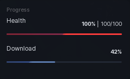

# Progress Bar

A filled bar for values between a min and a max. Useful for health, XP, or anything that moves on its own.

```lua
local bar = section:ProgressBar({
	Name = "Health",
	MinValue = 0,
	MaxValue = 100,
	Value = 100,
})

humanoid.HealthChanged:Connect(function(health)
	bar:SetValue(health)
end)
```

## Options

| Key | Type | Description |
| --- | --- | --- |
| `Name` | string | Label for the bar. |
| `MinValue` | number | Value at empty. Defaults to `0`. |
| `MaxValue` | number | Value at full. Defaults to `100`. |
| `Value` | number | Starting value. Defaults to `0`. |
| `Color` | Color3 | Fill colour. Theme accent if omitted. |
| `ShowPercentage` | boolean | Percent on the right. On by default. |
| `ShowFraction` | boolean | `42 / 100` style readout. Off by default. |
| `Animate` | boolean | Tween the fill on change. On by default. |
| `SpinningEnabled` | boolean | Animated gradient inside the fill. On by default. |
| `Callback` | function | Fires with the value each time it is set. |

## Methods

| Method | Description |
| --- | --- |
| `:SetValue(number, noAnimate?)` | Set the value. Pass `true` to snap instead of tweening. |
| `:GetValue()` | Returns the current value. |
| `:SetMin(number)` | Move the lower bound. |
| `:SetMax(number)` | Move the upper bound. |
| `:SetColor(Color3)` | Change the fill colour. |
| `:SetName(string)` | Change the label. |
| `:SetVisible(bool)` | Show or hide. |
| `:EnableSpinning(bool)` | Turn the gradient animation on or off. |
| `:Destroy()` | Remove the bar and its bindings. |

## Screenshot


