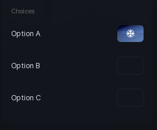

# Radio Button Group

Mutually exclusive choices: create the group, then add radio buttons to it. Picking one deselects the rest.

```lua
local group = section:RadioButtonGroup()

group:RadioButton({
	Name = "Option A",
	Default = true,
	Callback = function()
		print("A")
	end,
})

group:RadioButton({
	Name = "Option B",
	Callback = function()
		print("B")
	end,
})
```

## Options

The group itself takes no options. Each button added with `:RadioButton()` takes:

| Key | Type | Description |
| --- | --- | --- |
| `Name` | string | Label for the choice. |
| `Default` | boolean | Start selected. |
| `Icon` | string | Asset id shown instead of the default dot. |
| `Callback` | function | Runs when this choice is picked. |

The first button is selected automatically unless another one sets `Default = true`.

## Methods

| Method | Description |
| --- | --- |
| `:RadioButton(table)` | Add a choice. Returns the button handle. |
| `:Select(button)` | Select a button handle from this group. |
| `:GetSelected()` | Returns the selected button handle, or `nil`. |
| `:SetVisible(bool)` | Show or hide every button in the group. |
| `:GetVisible()` | Returns whether the group is showing. |
| `:Destroy()` | Remove the group and its buttons. |

To read the current choice, keep the handles yourself: `local a = group:RadioButton({ Name = "A" })`, then compare `group:GetSelected() == a`.

## Screenshot


