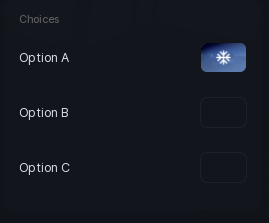

# Radio Button

A single on/off choice. Use it on its own for one option, or add it to a [Radio Button Group](radio-button-group.md) for a set.

```lua
section:RadioButton({
	Name = "Enable mode",
	Default = false,
	Callback = function(selected)
		print(selected)
	end,
})
```

## Options

| Key | Type | Description |
| --- | --- | --- |
| `Name` | string | Label for the choice. |
| `Default` | boolean | Start selected. Off by default. |
| `Icon` | string | Asset id shown instead of the default dot. |
| `Callback` | function | Runs with the new state when clicked. |

## Methods

| Method | Description |
| --- | --- |
| `:SetSelected(bool)` | Select or deselect. |
| `:GetSelected()` | Returns whether it is selected. |
| `:SetName(string)` | Change the label. |
| `:SetVisible(bool)` | Show or hide. |
| `:GetVisible()` | Returns whether it is showing. |
| `:EnableSpinning(bool)` | Turn the fill animation on or off. |
| `:Destroy()` | Remove the button and its bindings. |

## Screenshot


