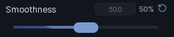

# Slider

A draggable value bar with a readout. Click anywhere on the track to jump, or drag the thumb.

```lua
section:Slider({
	Name = "Walk speed",
	Min = 16,
	Max = 100,
	Default = 16,
	Precision = 1,
	Callback = function(value)
		print(value)
	end,
})
```

## Options

| Key | Type | Description |
| --- | --- | --- |
| `Name` | string | Label above the track. |
| `Min` | number | Low end of the range. Defaults to `0`. |
| `Max` | number | High end of the range. Defaults to `100`. |
| `Increment` | number | Amount per step. `Step` works as an alias. Defaults to `1`. |
| `Default` | number | Starting value. Defaults to `50`. |
| `Precision` | number | Decimal places shown. Defaults to the increment's decimals. |
| `Callback` | function | Fires with the value while dragging. |
| `SpinningEnabled` | boolean | Animated gradient inside the fill. On by default. |

`Precision = 0` gives whole numbers, `Precision = 1` gives one decimal place. The callback fires as the player drags, so keep it light or gate the expensive work behind your own debounce.

## Methods

| Method | Description |
| --- | --- |
| `:UpdateValue(number)` | Set the value. Alias `:SetValue`. |
| `:GetValue()` | Returns the current value. |
| `:UpdateName(string)` | Change the label. |
| `:SetName(string)` | Same as `UpdateName`. |
| `:SetVisibility(bool)` | Show or hide. |
| `:GetVisible()` | Returns whether it is showing. |
| `:EnableSpinning(bool)` | Turn the fill animation on or off. |
| `:Destroy()` | Remove the slider and its bindings. |

## Screenshot


