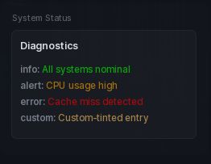

# Status

A small readout panel: a heading plus up to eight coloured lines. Handy for live API or server state.

```lua
local status = section:Status({
	Name = "API status",
	Entries = {
		{ "main", "Connected", "green" },
		{ "ping", "84ms", "orange" },
	},
})

status:SetEntry("ping", "42ms", "green")
```

## Options

| Key | Type | Description |
| --- | --- | --- |
| `Name` | string | Heading above the lines. |
| `Entries` | table | Array of `{ key, text, colour }` entries. |

Each entry is a plain array: the `key` is what you use to update it later, the `text` is the line itself, and the colour is one of `"green"`, `"orange"`, `"red"`, a hex string like `"#FF0000"`, or a `Color3`. Lines are rich text, so `<b>` and `<font>` tags work.

Eight entries is the cap. Anything past that is dropped.

## Methods

| Method | Description |
| --- | --- |
| `:SetEntries(table)` | Replace every line. |
| `:SetEntry(key, text, colour)` | Update the line with that key. |
| `:AddEntry(key, text, colour)` | Append a line. Pass `""` for no key. |
| `:GetEntry(key)` | Returns one entry. |
| `:GetEntries()` | Returns a copy of all entries. |
| `:SetName(string)` | Change the heading. |
| `:SetVisible(bool)` | Show or hide. |
| `:GetVisible()` | Returns whether it is showing. |
| `:Destroy()` | Remove the panel. |

## Screenshot


