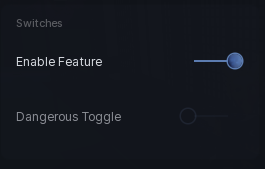

# Toggle

An on/off switch with a label.

```lua
section:Toggle({
	Name = "Auto farm",
	Default = false,
	Callback = function(on)
		print(on)
	end,
})
```

## Options

| Key | Type | Description |
| --- | --- | --- |
| `Name` | string | Label shown next to the switch. |
| `Default` | boolean | Starting state. Defaults to `false`. |
| `Callback` | function | Runs with the new state whenever it flips. |
| `Confirm` | table | Ask before changing. See below. |

## Confirm dialog

Pass a `Confirm` table for anything risky. It shows the same modal as `window:UINotification()` and only flips the toggle if the player confirms.

```lua
section:Toggle({
	Name = "Delete save",
	Confirm = {
		Enabled = true,
		Title = "Are you sure?",
		Description = "This wipes your progress.",
		TitleColor = Color3.fromRGB(255, 100, 100),
		ConfirmText = "Yes, do it",
		CancelText = "No, cancel",
	},
	Callback = function(on) end,
})
```

`Enabled` switches the whole thing on, `TitleColor` tints the heading, and the two text keys label the buttons. Everything else is optional.

## Methods

| Method | Description |
| --- | --- |
| `:UpdateState(bool)` | Set the state. Animates like a normal click. Alias `:SetState`. |
| `:GetState()` | Returns the current state. |
| `:UpdateName(string)` | Change the label. |
| `:SetName(string)` | Same as `UpdateName`. |
| `:SetVisibility(bool)` | Show or hide. |
| `:GetVisible()` | Returns whether it is showing. |
| `:Destroy()` | Remove the toggle and its bindings. |

## Screenshot


