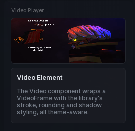

# Video

An inline `VideoFrame` in a section, for previews and loops.

```lua
local video = section:Video({
	Name = "Preview",
	VideoId = "rbxassetid://5670794788",
	Height = 140,
})

video:Play()
```

## Options

| Key | Type | Description |
| --- | --- | --- |
| `Name` | string | Label above the video. |
| `VideoId` | string | The video asset id. |
| `Loop` | boolean | Restart when it ends. On by default. |
| `Height` | number | Frame height in pixels. Defaults to `100`. |
| `Volume` | number | `0` to `1`. |

The video starts playing on its own and fades with the page like every other component.

## Methods

| Method | Description |
| --- | --- |
| `:Play()` | Start playback. |
| `:Pause()` | Pause it. |
| `:Stop()` | Stop and rewind. |
| `:SetVideo(string)` | Swap the video asset. |
| `:SetVolume(number)` | Change the volume. |
| `:GetVolume()` | Returns the current volume. |
| `:SetLoop(bool)` | Turn looping on or off. |
| `:SetHeight(number)` | Resize the frame. |
| `:SetFade(number, duration?)` | Fade the gradient overlay. |
| `:SetVisibility(bool)` | Show or hide. |
| `:Destroy()` | Remove the video. |

## Screenshot


