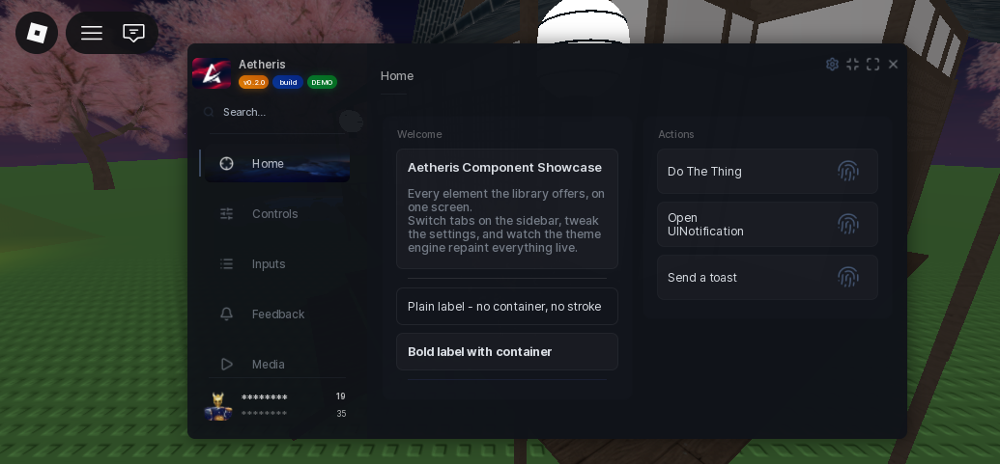
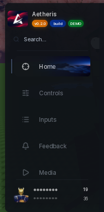
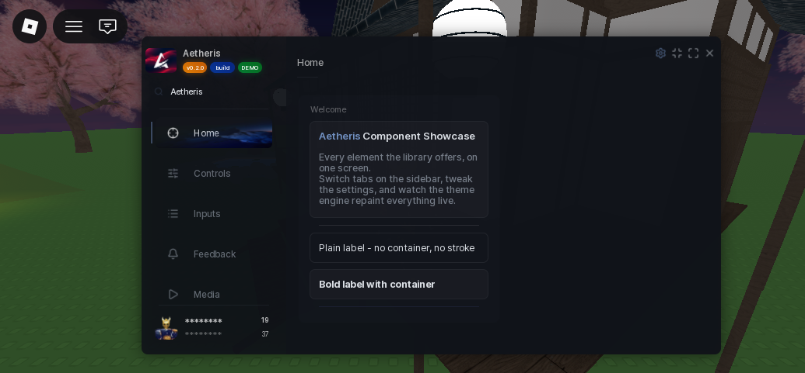
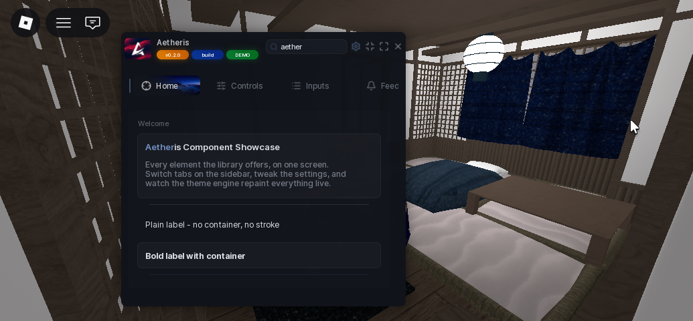
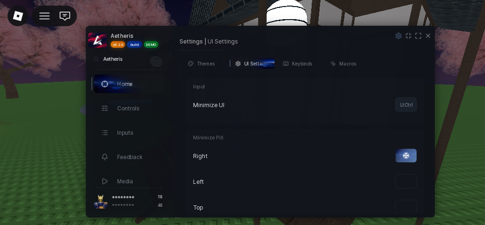
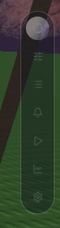
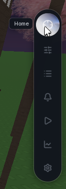

# Gallery

The library in action. Click any image to open it full size.



## The window

The full window: sidebar, tabs, content area and sections.

## Tabs and sidebar

Tab navigation along the sidebar.

## Search

The sidebar search filtering tabs.

## Compact mode

The window collapsed into its compact layout.

Compact mode with search in action.

## Settings

The built-in settings pages: Themes, UI Settings and Configs.

## Minimized state

When the window is minimized it collapses to a small pill on the side of the screen.

Resting.

Hovered.

## Every component

Individual component shots live on each page under [Components](../components.md). Popups and notifications are on the [Popups pages](../popups-and-notifications.md).
