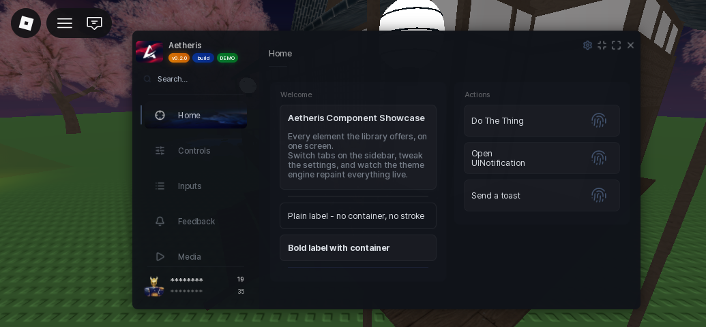

# Window

The window is the frame everything else lives in: title bar, sidebar, tabs, the settings gear, and the minimize pill.

```lua
local window = Aetheris:CreateWindow({
	Title = "My Script",
	Theme = "Umbral",
	MinimizeKey = "LeftControl",
})
```

## Options

| Key | Type | Description |
| --- | --- | --- |
| `Title` | string | Shown in the title bar. |
| `Theme` | string | Starting theme name. `"Default"` uses the launch theme. |
| `MinimizeKey` | string | Key that hides and restores the window. Defaults to `M`. |
| `Tags` | table | Up to three pills under the title. See [Tags](window/tags.md). |
| `SettingsPages` | table | Custom pages for the settings window. See [Settings Pages](window/settings-pages.md). |
| `DefaultSettingsPage` | string | Page the settings window opens on. |
| `AnimationStyle` | string | `"Smooth"` (default) or `"Snappy"`. |
| `DragStyle` | string | `"Smooth"` glides after the cursor, `"Instant"` snaps. |
| `DisplayOrder` | number | Z-order of the gui. |
| `Parent` | Instance | Put the gui somewhere specific instead of the default. |
| `ScreenGuiName` | string | Name of the ScreenGui when not in secure mode. |
| `IgnoreGuiInset` | boolean | Let the window sit under the topbar. |
| `AETHERIS_SECUREMODE` | boolean | Parent through `gethui` and rename to UUIDs. |
| `KeySystem` | table | Gate the window behind a key. See [Key System](key-system.md). |

A saved setting always beats the value you pass here: if the player changed the theme or minimize key in the settings window, that wins on the next launch.

## Methods

| Method | Description |
| --- | --- |
| `:Tab(name, icon)` | Add a sidebar page. Returns the tab. |
| `:Divider()` | Separator between tabs. |
| `:SetTitle(string)` | Change the title text. |
| `:SetTheme(string)` | Repaint everything to another theme. |
| `:SetFont(asset)` | Swap the font family. |
| `:SetCompact(bool)` | Collapse the sidebar into the pill row. |
| `:SetPillPosition(...)` | Move the minimized pill. |
| `:ToggleMinimize()` | Minimize or restore. |
| `:Toast(settings)` | Short self-dismissing message. |
| `:Alert(settings)` | Alert-style notification. |
| `:Error(settings)` | Error-style notification. |
| `:UINotification(settings)` | Modal confirm/cancel dialog. |
| `:DropdownPopUp(id, settings)` | Open a dropdown popup directly. |
| `:ColorPickerPopUp(id, settings)` | Open a picker popup directly. |
| `:HidePopups()` | Close any open popup. |
| `:OnDestroy(callback)` | Run something when the window is destroyed. |
| `:Destroy()` | Tear the window down. |

## Notifications in one line each

```lua
window:Toast({ Title = "Saved", Duration = 4 })
window:Alert({ Title = "Heads up", Description = "Key expires soon." })
window:Error({ Title = "Request failed", Description = "Bad response from the API." })
window:UINotification({
	Title = "Delete config?",
	Description = "This cannot be undone.",
	OnConfirm = function() end,
	OnCancel = function() end,
})
```

Toasts stack in the corner and dismiss themselves. `UINotification` blocks until the player picks one. Full options live in [Notifications](window/notifications.md).

## Layout

The window drags, resizes and maximizes from its edges, and the search box filters the active tab's rows as you type. `SetCompact(true)` swaps the sidebar for a pill row of tabs, which is the mobile-friendly view. Everything repaints live on `SetTheme`.

Tabs and sections are covered in [Core Concepts](core-concepts.md).

## Screenshot


