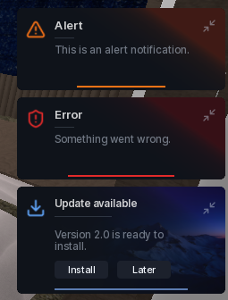

# Notifications

Two kinds: toasts that stack in the corner and dismiss themselves, and the modal dialog that waits for an answer.

## Toasts

```lua
window:Toast({ Title = "Saved", Description = "Config written to disk.", Duration = 4 })
window:Alert({ Title = "Heads up", Description = "Key expires soon." })
window:Error({ Title = "Request failed", Description = "Bad response from the API." })
```

The three wrappers only change the style: `Toast` is the neutral one, `Alert` the amber one, `Error` the red one. All of them take the same options.

| Key | Type | Description |
| --- | --- | --- |
| `Title` | string | Heading line. |
| `Description` | string | Body text, rich text allowed. |
| `Duration` | number | Seconds before it fades. |
| `Icon` | string | Asset id instead of the default glyph. |
| `IconColor` | Color3 | Tint the glyph. |
| `TitleColor` | Color3 | Tint the heading. |
| `GradientColor` | Color3 | Accent for the side gradient. |
| `Actions` | table | Buttons on the notification. |
| `BackgroundImage` | string | Image behind the body text. |
| `ShowBackground` | boolean | Draw that image. |

`Actions` is an array of `{ Name = "...", Callback = function() end }` buttons. They stay clickable until the toast expires, so use them for "Undo" style prompts.

## Modal

```lua
window:UINotification({
	Title = "Delete config?",
	Description = "This cannot be undone.",
	ConfirmText = "Delete",
	CancelText = "Cancel",
	OnConfirm = function()
		print("confirmed")
	end,
	OnCancel = function() end,
})
```

| Key | Type | Description |
| --- | --- | --- |
| `Title` | string | Heading line. |
| `Description` | string | Body text. |
| `TitleColor` | Color3 | Tint the heading. |
| `ConfirmText` | string | Left button label. |
| `CancelText` | string | Right button label. |
| `OnConfirm` | function | Runs when the player confirms. |
| `OnCancel` | function | Runs on cancel or escape. |

Only one modal shows at a time; `window:HidePopups()` closes it early.

## Screenshot


