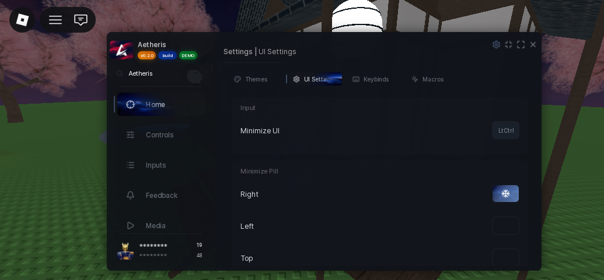

# Settings Pages

The settings window opens from the gear in the title bar. It always ships with three built-in pages, and you can add your own.

## Built-in pages

| Page | What it does |
| --- | --- |
| **Themes** | Browse and switch between the 45 built-in themes. |
| **UI Settings** | Window scale, minimize key, pill position, compact mode, volume, page animations, font and confirm-on-close. |
| **Configs** | Save and load per-game configs. See [Configs](../configs.md). |

## Adding a page

Pass a `SettingsPages` array when you create the window. Each entry takes a `Name`, an `Icon` and a `Build` function.

```lua
local window = Aetheris:CreateWindow({
	SettingsPages = {
		{
			Name = "Extra",
			Icon = Aetheris.Icons["settings"],
			Build = function(window, tab)
				local section = tab:Section({ Name = "General" })
				section:Toggle({ Name = "Something", Default = true })
			end,
		},
	},
	DefaultSettingsPage = "Themes",
})
```

`Build` receives the window and the settings tab. Long pages scroll, so add sections as you need them.

`DefaultSettingsPage` picks the page the settings window opens on — `"Themes"`, `"UI Settings"`, `"Configs"` or one of yours.

## Persisted settings

Anything changed on the UI Settings page is stored under `Aetheris/UI Settings/` when the executor has a file API: `Theme`, `UIScale`, `MinimizeKey`, `SpinsEnabled`, `ConfirmClose`, `Volume`, `PillPosition`, `CompactMode`, `PageAnimations`, `Font`, `MaskDisplayName` and `AutoSaveConfigs`. Without a file API they last for the session only.

A saved setting always beats the value you pass to `CreateWindow` on the next launch.

## Screenshot


