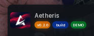

# Tags

Small pills under the window title, good for a version, a build or a status.

```lua
local window = Aetheris:CreateWindow({
	Title = "My Script",
	Tags = {
		"v1.0.0",
		{
			Name = "stable",
			BackgroundColor = Color3.fromRGB(6, 119, 47),
			TextColor = Color3.fromRGB(255, 255, 255),
			AccentColor = Color3.fromRGB(149, 255, 188),
		},
	},
})
```

## Options

Up to three tags. Each one is either a plain string or a table:

| Key | Type | Description |
| --- | --- | --- |
| `Name` | string | The text on the pill. |
| `BackgroundColor` | Color3 | Pill colour. |
| `TextColor` | Color3 | Text colour. |
| `AccentColor` | Color3 | Gradient accent along the edge. |

A string like `"v1.0.0"` takes its colours from the active theme. A table pins the three colours you give it, and theme switches leave them alone.

## Screenshot


